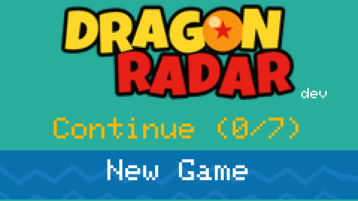
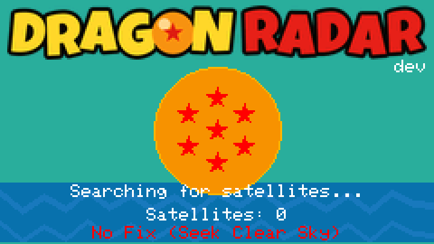
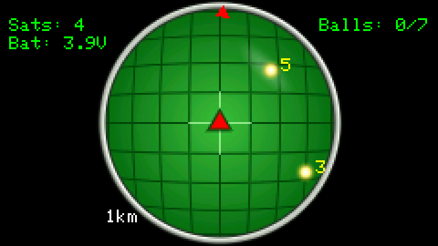
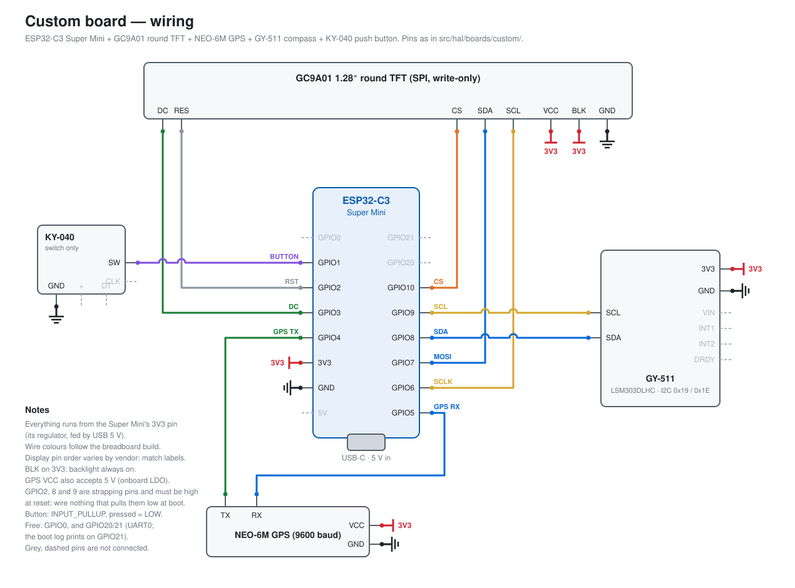

<p align="center">
  
</p>

<h1 align="center">Dragon Radar</h1>

<p align="center">
  <strong>A real-world Dragon Ball treasure hunt for ESP32 boards</strong>
</p>

<p align="center">
  <a href="https://github.com/Isonimus/esp32-dragon-radar/actions/workflows/ci.yml"></a>
  <a href="https://github.com/Isonimus/esp32-dragon-radar/actions/workflows/codeql.yml"></a>
  <a href="https://github.com/Isonimus/esp32-dragon-radar/releases/latest"></a>
  <a href="LICENSE"></a>
  
  
  <a href="https://www.npmjs.com/package/@isonimus/stele"></a>
  
</p>

<p align="center">
  <a href="#features">Features</a> •
  <a href="#screenshots">Screenshots</a> •
  <a href="#hardware-requirements">Hardware</a> •
  <a href="#installing-a-release">Install</a> •
  <a href="#controls">Controls</a> •
  <a href="#troubleshooting">Troubleshooting</a> •
  <a href="CONTRIBUTING.md">Contributing</a> •
  <a href="DISCLAIMER.md">Disclaimer</a>
</p>

A real-world Dragon Ball scavenger hunt game for the **M5Stack Cardputer ADV**, the **M5StickC Plus 2** and a custom ESP32-C3 board. Uses a live GPS feed to scatter seven virtual Dragon Balls around your location and renders a classic Bulma-style radar on the built-in display so you can hunt them down on foot.

> [!NOTE]
> Dragon Radar is an unofficial fan project, not affiliated with or endorsed by the Dragon Ball rights holders. The balls land at random points: you decide whether a spot is safe and legal to reach. See the [DISCLAIMER](DISCLAIMER.md).

---

## Features

| Feature | Details |
|---|---|
| **Multi-Device Support** | Runs on the **Cardputer ADV** and **M5StickC Plus 2** (landscape) and on a custom board with a 1.28" round display. |
| **Live GPS Tracking** | Parses NMEA sentences via `TinyGPS++` and projects your position onto the radar in real-time. |
| **Radar UI** | A lit green screen with a curved, CRT-like grid and a bright centre cross, framed by a grey bezel on the rectangular screens. The balls show as glowing blips that blink together. |
| **Dragon Ball Icons** | Authentic star patterns (1–7) using a custom trigonometric star renderer. |
| **Dynamic Zoom** | Five zoom levels (100 m → 20 km) to find balls near and far. |
| **Audio Feedback** | Canonical radar beep each time the blips light up. |
| **NVS Persistence** | Progress is saved automatically. Resume your hunt even after a reboot. |

---

## Screenshots

Captured over serial from a Cardputer ADV, and the radar from an M5StickC Plus2 in play (see [Taking screenshots](#taking-screenshots)), so these are the exact pixels the display shows.

<p align="center">
  <br>
  <em>Waiting for a GPS fix: the ball fills with stars while the receiver searches.</em>
</p>

<p align="center">
  <br>
  <em>The radar at the 1 km range, with two balls in reach, lit in the blink.</em>
</p>

---

## Hardware Requirements

### Supported Devices
- **M5Stack Cardputer ADV** (ESP32-S3; the original Cardputer's keyboard and codec are not supported)
- **M5StickC Plus 2** (ESP32-PICO-V3-02)
- **Custom board**: ESP32-C3 Super Mini wired to a GC9A01 1.28" round display, a NEO-6M GPS module (see below), a GY-511 (LSM303DLHC) compass and a KY-040 push button. It has no speaker and no battery.

### GPS Module
- **Cardputer ADV**: either official accessory, the M5Stack GPS Unit on the Grove port or the GPS/LoRa cap. The firmware listens on both at 115200 baud and keeps whichever sends valid NMEA first (logged as `[GPS] using the cap port` or `grove port`); swapping accessories needs a reboot.
- **M5StickC Plus 2**: the M5Stack GPS Unit (AT6668) on the Grove port, 115200 baud.
- **Custom board**: a GY-NEO6MV2 breakout ("NEO-6M") at 9600 baud. Many of these carry a clone chip rather than a u-blox NEO-6M; ours reports `SW=URANUS5` (GPS + BeiDou) and speaks the same NMEA, but with the stock patch antenna it heard satellites at only 13-29 dB-Hz and its first fix outdoors took over 20 minutes. Give it open sky, and expect a slow first fix.

### Pin Map Reference

| Function | Cardputer ADV | M5StickC Plus 2 | Custom board |
|---|---|---|---|
| GPS RX | 15 (cap) or 1 (Grove) | 33 | 4 (← NEO-6M TX) |
| GPS TX | 13 (cap) or 2 (Grove) | 32 | 5 (→ NEO-6M RX) |
| Audio/Buzzer | ES8311 over I2S (BCLK 41, WS 43, DATA 42) | PWM (2) | none |
| Primary Button | Enter (Zoom In) | Button A (Zoom In) | KY-040 SW on 1, tap (Zoom In) |
| Secondary Button | Backspace (Zoom Out; next menu item) | Button B (Zoom Out; next menu item) | Same button, double tap (Zoom Out; next menu item) |
| Menu Navigation | ↑ `;` / ↓ `.` (no Fn needed) | Button B only | Double tap only |
| Battery ADC | 10 | 34 | none (USB powered) |
| Display (SPI) | built in | built in | GC9A01: SCLK 6, MOSI 7, CS 10, DC 3, RST 2; backlight on 3.3 V |
| Compass (I2C) | none | none (MPU6886 IMU built in) | GY-511: SDA 8, SCL 9 |

The custom board's button uses `INPUT_PULLUP` and is active-low. GPIO2, GPIO8 and GPIO9 are ESP32-C3 strapping pins that must be high at reset: GPIO2 is the display's reset line, and the idle I2C bus holds GPIO8 and GPIO9 high, so wire nothing to them that could pull them low at boot. GPIO0 is not a strapping pin on the C3 (it is on the classic ESP32) and is free.

The custom board's full wiring, including power and the unused pins:



---

## Project Structure

```
esp32-dragon-radar/
├── platformio.ini          # Build configuration
├── data/                   # Source assets (Capsule Corp bitmap, title font); not flashed as files
├── src/
│   ├── main.cpp            # Entry point & state machine (board-agnostic)
│   ├── hal/                # Hardware abstraction: one interface per subsystem
│   │   ├── hal.h           # HardwareHAL bundle + getHAL()
│   │   └── boards/         # One folder per board, picked by build_src_filter
│   │       ├── custom/     # ESP32-C3 + GC9A01 + NEO-6M + LSM303 + button
│   │       ├── cardputer/  # M5Stack Cardputer ADV
│   │       └── m5stickc/   # M5StickC Plus 2
│   ├── audio/              # Melodies, tone sequencer, square-wave synth
│   ├── compass/            # LSM303 tilt-compensated compass (custom board)
│   ├── imu/                # MPU6886 driver (M5StickC)
│   ├── game/               # Ball placement, save/load, radar heading selection
│   ├── gps/                # NMEA parsing
│   ├── math/               # Haversine / bearing math
│   ├── render/             # Radar drawing, screen layout and text; logo images as C headers
│   └── debug/              # Serial screen capture
├── scripts/                # Release packaging, screen capture, doc linting, ADR index, title-logo renderer
├── test/                   # Native unit tests
├── adr/, slices/           # Decision records (see CONTRIBUTING.md)
└── docs/                   # Hardware drawings, quality bar
```

---

## Installing a release

Each [release](https://github.com/Isonimus/esp32-dragon-radar/releases) has two images per board, and a `SHA256SUMS.txt` to check them against:

| Board | Factory image (whole flash, at `0x0`) | esptool chip |
|---|---|---|
| Cardputer ADV | `dragon-radar-cardputer-<version>-factory.bin` | `esp32s3` |
| M5StickC Plus 2 | `dragon-radar-m5stickc-plus2-<version>-factory.bin` | `esp32` |
| Custom board | `dragon-radar-custom-<version>-factory.bin` | `esp32c3` |

Flash the factory image with [esptool](https://github.com/espressif/esptool) at offset `0x0` on every board:

```bash
pip install esptool
sha256sum -c SHA256SUMS.txt --ignore-missing
esptool --chip esp32s3 write-flash 0x0 dragon-radar-cardputer-v0.1.0-factory.bin
```

The `-app.bin` image is the bare application, for an app loader such as M5Launcher on the Cardputer or the StickC. The title screen shows the version you flashed; a build from source shows `dev`.

---

## Prerequisites

1.  **PlatformIO**: Install it through VS Code, or from the CLI with `pip install platformio`
2.  **USB Drivers**: Ensure your OS recognizes the ESP32 (CH9102 or S3-CDC).

---

## Build & Flash

### 1. Build Firmware

```bash
# For Cardputer
pio run -e cardputer

# For M5StickC Plus 2
pio run -e m5stickc-plus2

# For the custom board
pio run -e custom
```

### 2. Upload to Device

```bash
# For Cardputer
pio run -e cardputer -t upload

# For M5StickC Plus 2
pio run -e m5stickc-plus2 -t upload

# For the custom board
pio run -e custom -t upload
```

> [!NOTE]
> If you are using Linux and the port is busy, you might need to release it:
> `fuser -k /dev/ttyACM0` (or `ttyUSB0`)

### 3. Monitor Serial
```bash
pio device monitor -b 115200
```

### Regenerating the title logo

The "DRAGON RADAR" title is a pre-rendered image (ADR-0006), drawn from the Luckiest Guy font in `data/fonts/` (Apache 2.0). Never edit `src/render/dragon_radar_logo.h` by hand. Change `scripts/render-logo.py` and re-run it from the repo root, which needs Python 3 with Pillow:

```bash
python3 scripts/render-logo.py --preview logo-preview.png
```

### Taking screenshots

Every build answers a screenshot request on its serial console, so the README's shots come from the firmware rather than from a camera pointed at the panel. With the board running and the monitor closed (it holds the port):

```bash
python3 scripts/capture_screen.py --port /dev/ttyACM0 --count 20
```

This writes 20 PNGs to `shots/` (ignored by git), each pixel drawn as a 3 × 3 block (`--scale`). Take a burst and keep the best frame: the satellite-search screen lights all seven stars for only 400 ms of every 2.8 s, and the radar's blips are dark for half of every 1.8 s blink. Opening the port does not reset the board (the script leaves DTR and RTS high; lowering them resets it), so a game with a GPS fix carries on; if the board resets anyway, the script says so. It needs pyserial, which PlatformIO installs, and Pillow. A frame takes under a second over the Cardputer's and the custom board's USB, and about 6 s over the StickC's 115200-baud link.

---

## Controls

| Device | Action |
|---|---|
| **Cardputer ADV** | **Enter** (Select / Zoom In), **Backspace** (Navigate / Zoom Out), **↑ `;` / ↓ `.`** (Move through menus), **Backspace Long** (Mute), **Enter Long** (Shutdown) |
| **M5StickC Plus 2** | **Btn A** (Select / Zoom In), **Btn B** (Navigate / Zoom Out), **Btn B Long** (Mute), **Btn A Long** (Shutdown) |
| **Custom board** | **Tap** (Select / Zoom In), **Double tap** (Navigate / Zoom Out), **Long press** (Zoom Out on the radar; restart from the menu, as there is no power switch) |

---

## Game States

```
SPLASH → MENU → SETTINGS → GPS_WAIT → SCATTERING → RADAR ⇄ COLLECTED → WIN
                  ↑          ↑ (Continue)                                  │
                  │          └─── skips SCATTERING ──────────────→ RADAR   │
                  └────────────────────────────────────────────────────────┘
```

1. **SPLASH**: Capsule Corp logo fade animation.
2. **MENU**: Continue saved game or start new. Shows progress (X/7 balls found). Starting a new game keeps the old save until the new balls are scattered, so a reboot before then can still continue it.
3. **SETTINGS**: Configure scatter distance (Easy/Medium/Hard) and sound (ON/OFF).
4. **GPS_WAIT**: Acquiring satellite fix. Needs a current fix (at most 5 s old) from ≥ 4 satellites.
5. **SCATTERING**: Animated 7-ball explosion around your current location.
6. **RADAR**: Main gameplay. Walk towards the dots on the radar. A red **NOT SAVED** under the ball count means the last save to flash failed; a reboot would lose progress since the last successful save. It clears at the next save that succeeds.
7. **COLLECTED**: Animated display of the ball found.
8. **WIN**: All 7 collected! Shenron is summoned. Press to return to menu.

---

## Dependencies

| Library | Version | Purpose |
|---|---|---|
| [LovyanGFX](https://github.com/lovyan03/LovyanGFX) | 1.2.19 | Display driver (all boards) |
| [TinyGPS++](https://github.com/mikalhart/TinyGPSPlus) | 1.1.0 | NMEA GPS parsing |
| [LSM303](https://github.com/pololu/lsm303-arduino) | 3.0.1 | Compass (custom board) |
| Preferences | built-in | NVS flash storage |

Versions are pinned exactly, so every build uses the code a release was tested with.

---

## Troubleshooting

| Problem | Solution |
|---|---|
| **No GPS fix** | Go outside with a clear view of the sky. Cold start can take up to 90 seconds. |
| **No `[GPS] using the … port` line (Cardputer ADV)** | Neither port has sent valid NMEA. In the `[GPS cap]` / `[GPS grove]` lines, `chars=0` means nothing is arriving: check the accessory is seated. `chars` rising with `parsed=0` means a module at a baud other than 115200. |
| **No audio (Cardputer ADV)** | Check the boot log for `Setup: Audio FAILED`; the `[audio] ... FAILED` line before it names the step (I2S, ES8311 codec or synth task). The game carries on silent. |
| **Screen stays black or shows a red message at boot** | Boot stops when a part the game cannot run without fails; the boot log's `Setup: ... - halting` line names it (display, input, or frame-buffer memory). |
| **Port Busy (Linux)** | Run `fuser -k /dev/ttyACM0` to kill the blocking process. |
| **Device not seen** | Check USB cable and drivers. Some cables are power-only. |

---

## Contributing

Bug reports, ideas and pull requests are welcome. Start with [CONTRIBUTING.md](CONTRIBUTING.md); please follow the [Code of Conduct](CODE_OF_CONDUCT.md), and report security issues privately as described in [SECURITY.md](SECURITY.md).

---

## License

[MIT](LICENSE). The title font, Luckiest Guy, is under the Apache License 2.0 (`data/fonts/LuckiestGuy-LICENSE.txt`).

Dragon Ball and everything related to it belongs to its rights holders; this is an unofficial fan project. See the [DISCLAIMER](DISCLAIMER.md).

---

*Built by a Dragon Ball fan who wanted an excuse to go outside.* 🟠
